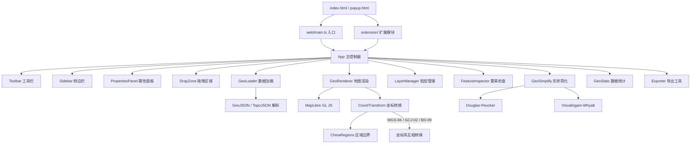
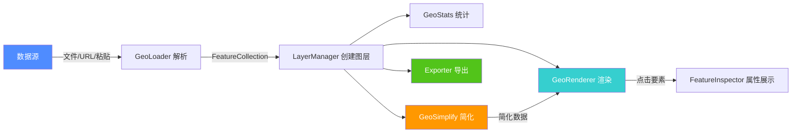
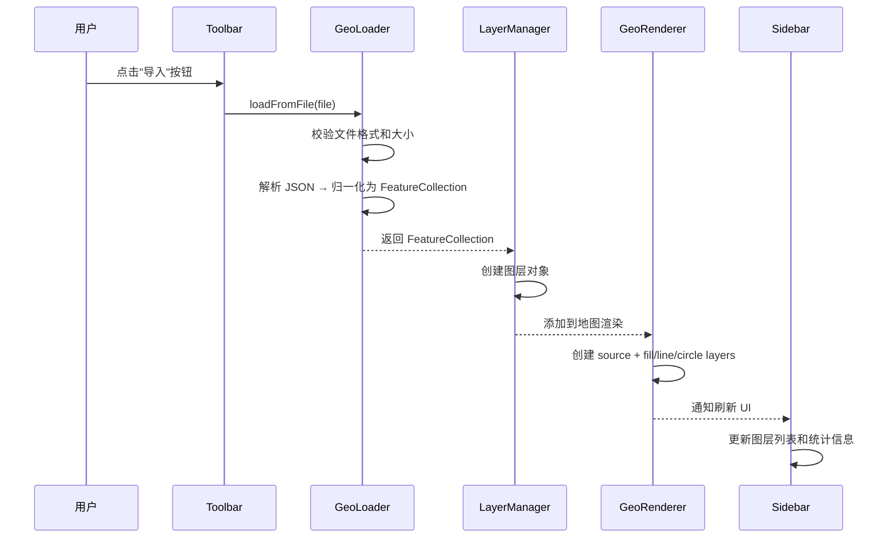
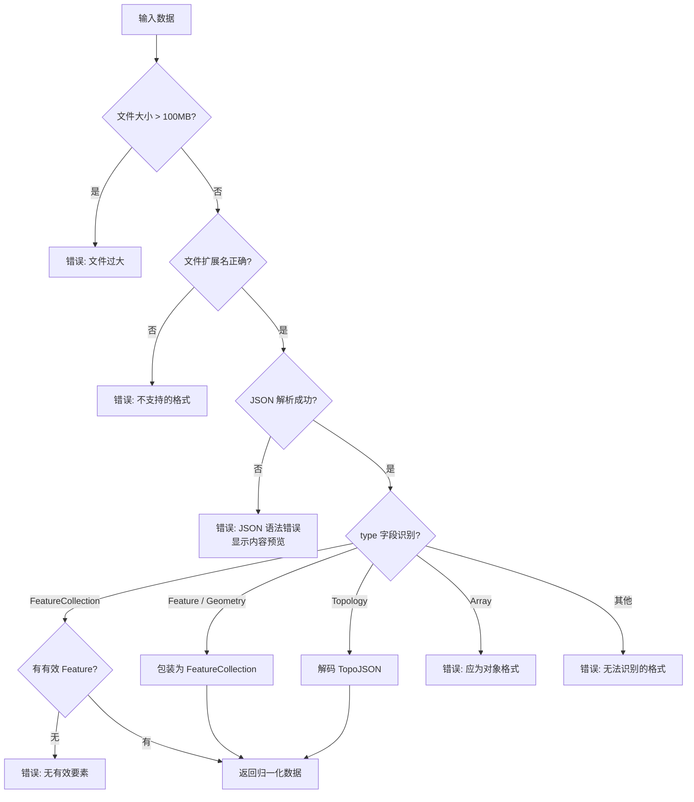

# GeoJSON 查看器

在浏览器中直接预览和检查 GeoJSON 数据。同时支持 **Chrome 浏览器扩展** 和 **独立网页应用** 两种使用方式。

## 功能特性

- **多种导入方式**: 文件上传、拖拽文件、URL 加载、粘贴 JSON 文本
- **交互式地图**: 基于 MapLibre GL JS 的地图渲染，支持缩放/平移，自动适配数据范围
- **多图层管理**: 支持同时加载多个 GeoJSON 为独立图层，可切换可见性、拖拽排序、重命名、删除
- **要素查看**: 点击地图上的要素查看其所有属性信息，支持搜索过滤
- **数据统计**: 显示要素数量、几何类型分布、边界框、估算面积和周长
- **形状简化**: Douglas-Peucker 和 Visvalingam-Whyatt 两种算法，实时滑块预览，简化前后顶点数对比
- **导出功能**: 导出为 GeoJSON / TopoJSON，或复制 JSON 到剪贴板
- **多坐标系转换**: 支持 WGS-84（GPS 原始坐标）、GCJ-02（国测局/火星坐标）、BD-09（百度坐标）三种坐标系实时切换，基于阿里 DataV 简化边界精确判断大陆/港澳台/境外区域
- **省市区下钻**: 点击省份/城市逐级深入到区县（可选功能，详见 [下钻功能配置](./DRILL_DOWN_GUIDE.md)）
- **数据校验**: 智能检测导入数据的格式和内容错误，提供详细的中文错误提示
- **Chrome 扩展**: 自动检测网页中的 GeoJSON 链接，快速粘贴预览

## 技术栈

| 类别 | 技术 |
|------|------|
| 构建工具 | Vite 5 |
| 编程语言 | TypeScript |
| 地图引擎 | MapLibre GL JS 4.x |
| UI 框架 | 原生 DOM（无框架） |
| 构建目标 | Chrome Extension (Manifest V3) + Web App |

## 快速开始

### 环境要求

- Node.js >= 16
- npm >= 8

### 安装

```bash
cd geo-viewer
npm install
```

### 开发模式

```bash
npm run dev
```

启动开发服务器 `http://localhost:5173`，支持 HMR 热更新。

### 构建

```bash
# 网页生产构建 -> dist/
npm run build

# Chrome 扩展构建 -> dist-ext/
npm run build:ext

# Chrome 扩展开发构建（不压缩，含 sourcemap）
npm run build:ext:dev
```

### 安装 Chrome 扩展

1. 运行 `npm run build:ext:dev`
2. 打开 `chrome://extensions`
3. 开启“开发者模式”
4. 点击“加载已解压的扩展程序”，选择 `dist-ext/` 文件夹

### 常用开发命令

```bash
# 下载省市区 GeoJSON 数据（首次初始化，约 4-5 分钟）
node scripts/download-geo-all.cjs

# 检查 geo 数据完整性
node scripts/check-geo.cjs

# 检查目录分类和数据完整性
node scripts/check-geo-classify.cjs

# 打包 Chrome 扩展为 ZIP
npm run pack:zip

# 打包 Chrome 扩展为 CRX（本地分发）
npm run pack:crx

# 生成扩展图标（需要安装 sharp）
node scripts/generate-icons.cjs
```

## 开发脚本

项目提供了丰富的开发脚本，用于数据下载、验证、打包等任务。

### 核心脚本

| 脚本 | 功能 | 使用场景 |
|------|------|---------|
| `download-geo-all.cjs` ⭐ | 批量下载省市区数据 | 初始化下钻数据集 |
| `check-geo-classify.cjs` ⭐ | 检查分类和完整性 | 验证数据正确性 |
| `check-geo.cjs` | 检查数据完整性 | 验证下载的文件 |
| `pack-extension.cjs` | 打包 Chrome 扩展 | 发布 ZIP/CRX 包 |
| `download-datav-geo.cjs` | 下载单个区域 | 获取特定边界数据 |
| `extract-china-regions.cjs` | 提取区域边界 | 生成坐标转换数据 |
| `generate-icons.cjs` | 生成扩展图标 | 从 SVG 生成 PNG |
| `fix-geo-classify.cjs` ✅ | 修复分类问题 | 已完成，通常不需要 |

### 下载脚本配置

`download-geo-all.cjs` 支持通过环境变量配置并发参数：

```bash
# 默认配置（5 并发，100ms 间隔，约 4 分钟）
node scripts/download-geo-all.cjs

# 快速模式（10 并发，50ms 间隔，约 2 分钟）
set CONCURRENCY=10 && set DELAY=50 && node scripts/download-geo-all.cjs  # Windows
CONCURRENCY=10 DELAY=50 node scripts/download-geo-all.cjs                # Linux/Mac

# 保守模式（1 并发，200ms 间隔，约 18 分钟）
set CONCURRENCY=1 && set DELAY=200 && node scripts/download-geo-all.cjs

# 下载指定省份
node scripts/download-geo-all.cjs 510000              # 四川省
node scripts/download-geo-all.cjs 110000 310000 440000  # 北京、上海、广东
```

**配置参数**：

| 参数 | 默认值 | 范围 | 说明 |
|------|--------|------|------|
| `CONCURRENCY` | 5 | 1-10 | 并发下载数 |
| `DELAY` | 100 | 50-1000 | 请求间隔（毫秒） |
| `TIMEOUT` | 15000 | 5000-30000 | 超时时间（毫秒） |

**性能对比**：

| 模式 | 并发 | 间隔 | 预计耗时 | 适用场景 |
|------|------|------|---------|----------|
| 保守模式 | 1 | 150ms | ~18 分钟 | 网络不稳定 |
| **默认配置** ⭐ | 5 | 100ms | ~4 分钟 | 一般使用（推荐） |
| 快速模式 | 10 | 50ms | ~2 分钟 | 网络良好 |

### 脚本详细说明

#### `download-geo-all.cjs` ⭐

批量下载全国省市区三级 GeoJSON 数据（约 3600 个文件）。

**特性**：
- ✅ 自动跳过已存在的文件（增量下载）
- ✅ 自动分类到正确目录（city/ 或 district/）
- ✅ 同时下载 .json 和 _full.json
- ✅ 可配置并发数和请求间隔
- ✅ 遵守 DataV API 限制（并发 ≤10，间隔 ≥100ms）

**输出**：
```
geo/
├── country/    # 2 个文件（全国轮廓）
├── province/   # 67 个文件（省级）
├── city/       # 345 个文件（市级）
└── district/   # 3200 个文件（区县）
```

#### `check-geo-classify.cjs` ⭐

检查目录分类和数据完整性，会验证：
- `city/` 目录是否有误放的 district 文件
- 特定省份（四川、重庆、北京、上海）的数据完整性
- 各级别文件数量和大小

#### `check-geo.cjs`

检查 geo 数据完整性，统计各级行政区划的文件数量，检测缺失文件。

#### `pack-extension.cjs`

将构建好的 Chrome 扩展打包为 ZIP 或 CRX 文件。

```bash
npm run pack:zip   # 打包为 ZIP
npm run pack:crx   # 打包为 CRX
npm run pack:both  # 同时打包
```

**输出**：`release/geo-viewer-v1.0.0.zip` 或 `.crx`

#### `download-datav-geo.cjs`

从阿里 DataV GeoAtlas 下载指定 adcode 的 GeoJSON 数据。

```bash
node scripts/download-datav-geo.cjs 110000  # 下载北京
```

#### `extract-china-regions.cjs`

从省级 GeoJSON 数据中提取中国大陆、港澳台、境外区域边界，生成 `src/core/china-regions.ts`。

#### `generate-icons.cjs`

从 SVG 源文件生成 Chrome 扩展所需的多尺寸 PNG 图标（16x16、48x48、128x128）。

**依赖**：需要安装 `sharp`
```bash
npm install --save-dev sharp
```

#### `fix-geo-classify.cjs` ✅

修复 GeoJSON 文件的行政区划分类问题。**状态**：✅ 已完成，通常不需要使用。

**历史问题**：直辖市的子区域曾被误分类到 city/ 目录，现在下载脚本已包含正确的分类逻辑。

### 常用工作流

#### 首次初始化项目

```bash
# 1. 安装依赖
npm install

# 2. 下载所有 geo 数据（约 4 分钟）
node scripts/download-geo-all.cjs

# 3. 验证数据完整性
node scripts/check-geo.cjs

# 4. 验证目录分类
node scripts/check-geo-classify.cjs

# 5. 启动开发服务器
npm run dev
```

#### 准备发布扩展

```bash
# 1. 构建扩展（生产模式）
npm run build:ext

# 2. 生成图标（如果需要）
node scripts/generate-icons.cjs

# 3. 打包为 ZIP
npm run pack:zip

# 4. 上传到 Chrome Web Store
# 使用 release/geo-viewer-vX.X.X.zip
```

### 注意事项

1. **DataV API 限制**
   - 请求频率：建议间隔 100ms 以上
   - 并发数：建议不超过 10 个并发
   - 脚本会自动检测并提示配置是否符合限制

2. **Geo 数据存储**
   - `geo/` 和 `public/geo/` 已添加到 `.gitignore`
   - 约 100-200MB，不提交到 Git
   - 如需提交，请修改 `.gitignore`

3. **依赖安装**
   - 图标生成需要 `sharp`：`npm install --save-dev sharp`
   - Windows 用户可能需要安装构建工具

4. **故障排查**
   - 下载失败：降低并发数和延迟
   - 分类错误：运行 `check-geo-classify.cjs` 检查
   - 图标生成失败：安装 `sharp` 依赖

## 构建模式

| 命令 | 模式 | 输出目录 | 下钻功能 | 说明 |
|------|------|----------|---------|------|
| `npm run dev` | development | 开发服务器 | ✅ 默认启用 | HMR 热更新，端口 5173 |
| `npm run build` | production | `dist/` | ✅ 默认启用 | 压缩后的网页构建 |
| `npm run build:ext` | extension | `dist-ext/` | ❌ 默认禁用 | 生产环境 Chrome 扩展 |
| `npm run build:ext:dev` | extension-dev | `dist-ext/` | ❌ 默认禁用 | 开发环境扩展（含 sourcemap） |
| `npm run build:ext:drill` | extension | `dist-ext/` | ✅ 强制启用 | 带下钻功能的 Chrome 扩展 |

> 💡 **关于下钻功能**：省市区下钻需要约 3600 个 GeoJSON 文件（100-200MB）。Chrome 扩展默认禁用此功能以减小包体积。详见 [下钻功能配置指南](./DRILL_DOWN_GUIDE.md)。

## 项目架构

### 整体架构图



### 数据流



### 模块交互流程



### 数据校验流程



## 项目结构

```
geo-viewer/
├── src/                          # 源代码
│   ├── core/                    # 核心业务逻辑
│   │   ├── app.ts               # 应用主控制器，协调所有模块
│   │   ├── coord-transform.ts   # 坐标系转换（WGS84/GCJ-02/BD-09）
│   │   ├── china-regions.ts     # 中国区域边界数据（阿里 DataV 简化版）
│   │   ├── geo-loader.ts        # 数据加载与校验（文件/URL/文本）
│   │   ├── geo-renderer.ts      # MapLibre GL 地图渲染器
│   │   ├── layer-manager.ts     # 图层增删改查操作
│   │   ├── feature-inspector.ts # 要素属性展示与查询
│   │   ├── geo-stats.ts         # 面积/周长/边界框统计
│   │   ├── geo-simplify.ts      # Douglas-Peucker + Visvalingam 简化算法
│   │   ├── exporter.ts          # GeoJSON/TopoJSON 导出工具
│   │   ├── drill-down.ts        # 省市区下钻功能（可选）
│   │   └── types.ts             # TypeScript 类型定义
│   ├── ui/                      # DOM UI 组件
│   │   ├── sidebar.ts           # 图层列表 + 统计信息面板
│   │   ├── toolbar.ts           # 顶部操作工具栏
│   │   ├── properties-panel.ts  # 底部要素属性面板
│   │   ├── drop-zone.ts         # 拖拽上传覆盖层
│   │   └── toast.ts             # Toast 消息提示
│   ├── styles/                  # CSS 样式文件
│   ├── web/main.ts              # 网页应用入口
│   └── extension/               # Chrome 扩展模块
│       ├── manifest.json        # Manifest V3 配置
│       ├── background.ts        # Service Worker 后台脚本
│       ├── popup.ts             # 弹出窗口脚本
│       └── content.ts           # 内容脚本（页面注入）
├── scripts/                     # 开发辅助脚本（详见 scripts/README.md）
│   ├── download-geo-all.cjs     # 批量下载省市区 GeoJSON 数据
│   ├── download-datav-geo.cjs   # 从阿里 DataV 下载单个区域
│   ├── check-geo.cjs            # 检查 geo 数据完整性
│   ├── pack-extension.cjs       # 打包 Chrome 扩展（ZIP/CRX）
│   ├── generate-icons.cjs       # 生成扩展图标
│   ├── extract-china-regions.cjs # 提取区域边界
│   └── fix-geo-classify.cjs     # 修复 GeoJSON 分类
├── geo/                         # GeoJSON 省市区数据（已 .gitignore）
│   ├── country/                 # 全国轮廓（100000.json）
│   ├── province/                # 省级数据（34个）
│   ├── city/                    # 市级数据（约345个）
│   └── district/                # 区县数据（约3200个）
├── public/                      # 静态资源
│   ├── geo/                     # 公共 geo 数据（已 .gitignore）
│   └── icons/                   # Chrome 扩展图标
├── dist/                        # Web 生产构建输出
├── dist-ext/                    # Chrome 扩展构建输出
├── release/                     # 扩展打包文件（ZIP/CRX）
├── .env.example                 # 环境变量配置示例
├── DRILL_DOWN_GUIDE.md          # 下钻功能配置指南
├── index.html                   # 网页主页面
├── vite.config.ts               # 多模式 Vite 构建配置
├── tsconfig.json
└── package.json
```

## 支持的数据格式

| 格式 | 说明 | 导入 | 导出 |
|------|------|------|------|
| GeoJSON FeatureCollection | 标准要素集合 | ✅ | ✅ |
| GeoJSON Feature | 单个要素 | ✅ | ✅（自动包装） |
| GeoJSON Geometry | 单个几何体 | ✅ | ✅（自动包装） |
| TopoJSON | 拓扑格式（delta 编码） | ✅ | ✅ |
| `.geojson` / `.json` / `.topojson` | 文件扩展名 | ✅ | ✅ |

## 数据校验规则

导入数据时会自动进行以下校验：

1. **文件大小**: 超过 100MB 时拒绝加载并提示
2. **文件扩展名**: 仅接受 `.geojson`、`.json`、`.topojson`
3. **URL 协议**: 仅支持 `http://` 和 `https://`
4. **JSON 语法**: 解析失败时显示内容预览，帮助定位问题
5. **数据格式**: 检测 type 字段，提示支持的格式类型
6. **内容有效性**: FeatureCollection 中没有有效 Feature 时报错
7. **TopoJSON 完整性**: 解码后无有效几何要素时报错

## 形状简化算法

- **Douglas-Peucker**: 经典递归分割算法，适用于折线数据，基于最大垂直距离判断
- **Visvalingam-Whyatt**: 基于三角形面积的迭代删除算法，简化效果更自然

## 与同类工具的对比及推荐功能

参考 [mapshaper.org](https://mapshaper.org/) 和 [geojson.io](https://geojson.io/) 等同类工具，以下功能推荐在后续版本中实现：

| 功能 | 说明 | 来源 |
|------|------|------|
| 鼠标坐标显示 | 地图悬停时实时显示经纬度坐标 | geojson.io |
| 多底图切换 | 支持卫星图、地形图、暗色主题等多种底图 | mapshaper / geojson.io |
| 要素绘制 | 在地图上直接绘制点、线、多边形 | geojson.io |
| 表格视图 | 以表格形式展示所有要素的属性数据 | geojson.io |
| 空间分析 | 裁剪（clip）、融合（dissolve）、缓冲（buffer） | mapshaper |
| KML/GPX 导入 | 支持更多地理数据格式的导入 | geojson.io / mapshaper |
| 坐标参考系 | 支持投影转换（WGS84、Web Mercator 等） | mapshaper |
| 暗色模式 | 深色 UI 主题，降低长时间使用的视觉疲劳 | geojson.io |
| 文件拖拽排序 | 在侧边栏中拖拽调整图层顺序 | ✅ 已实现 |
| 顶点数对比 | 简化前后顶点数量和减少百分比显示 | ✅ 已实现 |
| 数据校验提示 | 导入错误时提供详细的中文错误信息 | ✅ 已实现 |

## 开源协议

MIT
